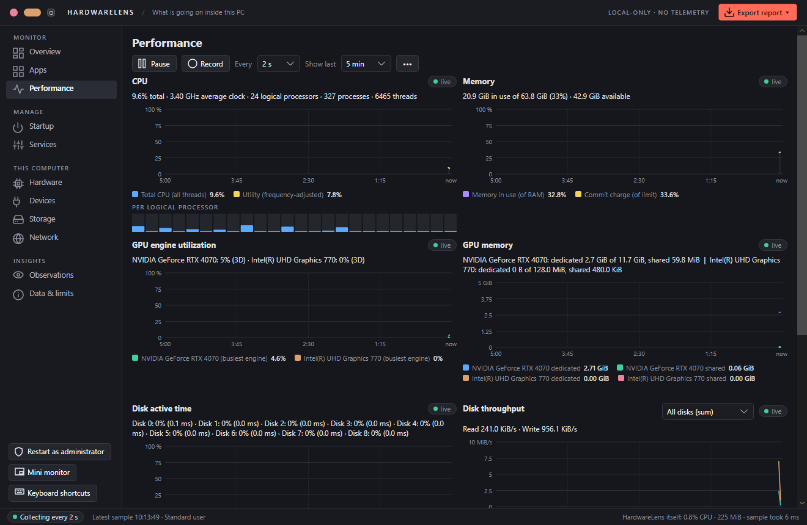

# HardwareLens

A portable Windows desktop utility for understanding your hardware, finding what is using your PC, and managing apps, startup entries, and services. Built with C#, .NET 10, and Avalonia.

[Download for Windows x64](https://github.com/MadMoriarty/HardwareLens/releases/latest) · [User guide](docs/user-guide.md) · [Build status](https://github.com/MadMoriarty/HardwareLens/actions)



The screenshot shows the actual application with live readings from a development PC. Available counters vary by hardware and driver.

## What it does

- **Overview:** resource usage, grouped apps, hardware findings, and locally saved incident context.
- **Apps:** grouped processes, usage details, close/force-end actions, and process priority.
- **Performance:** CPU, memory, GPU, disk, and network charts; adjustable sampling, history, CSV recording, and a mini monitor.
- **Startup and Services:** inspect startup entries, enable/disable them, and start/stop/restart services subject to Windows permissions.
- **Hardware and Devices:** CPU, memory modules, board, BIOS, graphics, disks, battery, and device information reported by Windows.
- **Storage and Network:** volume information, folder-size scanning, and adapter details.
- **Observations:** sustained resource pressure and hardware findings with explanations and measurement limits.
- **Reports:** HTML and JSON exports, plus comparison of two exported JSON snapshots. Device identifiers are excluded by default.

No account, cloud backend, telemetry service, installed driver, or background agent is required. Settings and incident records are written locally. Management actions can change Windows state; read [permissions and privacy](docs/permissions-and-privacy.md).

## Getting started

Requirements: Windows x64 on a .NET 10 supported Windows version. The app targets Windows; it is not a Linux/macOS hardware monitor.

1. Download `HardwareLens-win-x64.zip` from [Releases](https://github.com/MadMoriarty/HardwareLens/releases/latest), or build a portable copy using the instructions below.
2. Extract the entire package into a writable folder and run `HardwareLens.exe`.
3. Start as a standard user. Allow several readings for rate counters, then open **Overview**, **Apps**, or **Performance**.
4. Read **Data & limits** when a value is unavailable. Use **Restart as administrator** only when an action or source needs additional rights.

Portable builds include .NET, so users do not need to install a runtime. Builds are unsigned; Windows may show a SmartScreen warning.

## Build from source

Install the .NET 10 SDK selected by `global.json`, then run from the repository root:

```powershell
dotnet test tests/HardwareLens.Tests/HardwareLens.Tests.csproj -c Release
./tools/build.ps1
```

The script tests, publishes, and packages `artifacts/HardwareLens-win-x64.zip`. See [the build guide](docs/build.md) for development commands and screenshot capture.

## Guides

- [User guide](docs/user-guide.md): navigation, monitoring, management, exports, and troubleshooting.
- [Permissions and privacy](docs/permissions-and-privacy.md): elevation, local files, identifiers, and cleanup.
- [Build and architecture](docs/build.md): projects, tests, packaging, and limitations.
- [Security policy](SECURITY.md), [contributing](CONTRIBUTING.md), and [third-party notices](THIRD-PARTY-NOTICES.md).

HardwareLens complements [EventLens](https://github.com/MadMoriarty/EventLens), a separate Windows Event Log investigator. Each app builds and runs independently.

## Limits

Missing counters are shown as unavailable, not zero. GPU, storage reliability, temperature, and wear data depend on Windows APIs, devices, drivers, and permissions. HardwareLens does not install a sensor driver or claim complete SMART/sensor coverage. An observation suggests a next check; it does not prove a root cause. Ending an app may lose unsaved work, and stopping a service may interrupt dependent features.

## License

[MIT](LICENSE). Dependencies retain their own licenses; see [third-party notices](THIRD-PARTY-NOTICES.md).
